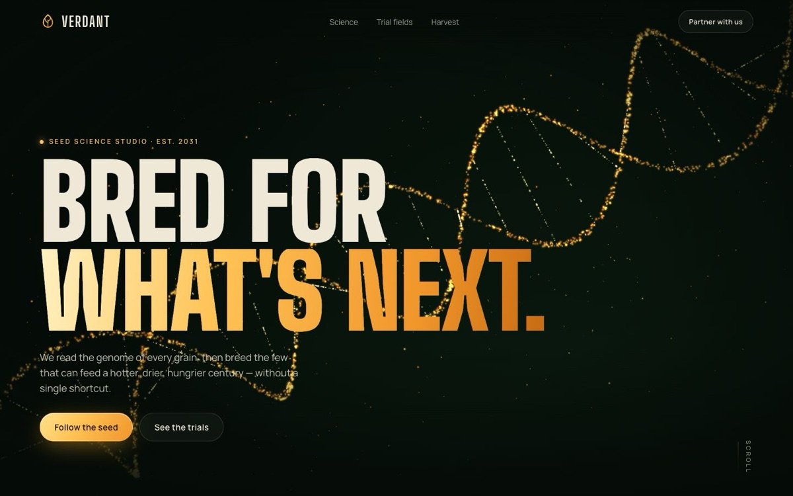

# Verdant Genetics

[](https://tabishhassan5121472.github.io/verdant-genetics/)


A cinematic, dark landing page for a fictional seed-science studio: a golden particle DNA helix that breaks apart into a seed, then scatters into a field of stars.

**Live demo:** [https://tabishhassan5121472.github.io/verdant-genetics/](https://tabishhassan5121472.github.io/verdant-genetics/)

## Techniques
- **Canvas 2D particle engine.** About 4,200 additive-blended glow sprites, with hand-rolled 3D rotation and perspective projection. The particles react to the cursor through eased screen-space repulsion and tilt.
- **Scroll-driven morphing.** The particles move from helix to seed to starfield, with a random delay per particle and a burst-scatter between shapes. The canvas sits in a CSS `position: sticky` stage and is scrubbed with GSAP ScrollTrigger.
- **SVG sprout timeline.** The pinned, scrubbed scene animates seed halves cracking open, stroke-drawn roots and stem, and leaves unfurling from their bases.
- **Count-up stats** run with GSAP when they scroll into view.
- **Horizontal pinned "Trial fields".** The landscapes are generated SVG (hills, perspective crop rows, foreground blades, sun and moon). Each layer moves for parallax through `containerAnimation`, and every time of day has its own colour grading.
- **Generated SVG ear of corn** with roughly 300 kernels that follow the cob's cylindrical curve and pop in row by row.
- Handles `prefers-reduced-motion`, caps DPR at 2, pauses the render loop when it is offscreen or the tab is hidden, and uses no images.

Built with plain HTML/CSS/JS, plus GSAP 3.12.5 and ScrollTrigger from cdnjs.


## Run locally

```bash
npx serve .
```

## License

MIT — free to learn from and reuse.
